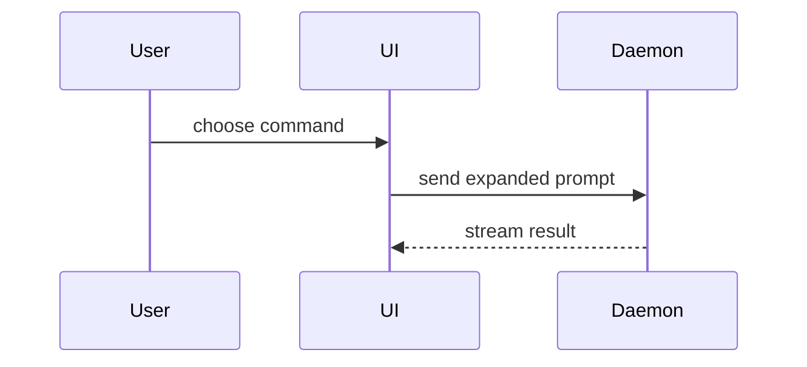

## The authorizing gate

Before writing the body, read the mission document and the gate decision.

- If the gate is approved, state the decision in neutral, general language.
  Never reproduce the words, mention the user, or name who decided. The merge is
  the approval.
- If the gate is pending, open the PR as a draft and say it is a proposal, not a
  decision. Do not write "approved" anywhere.
- If the scope is a rule plus a file pattern, the body names the rule and the
  pattern, not a per-file list.
- State the current problem, the route, and the alternative rejected. Do not
  carry history of the issue or mission.

Why: the prior PR looked approved because the body said so. The body cannot grant
the gate; it can only make the decision visible.

Use this template for writing the PR body:

```markdown
## Why

<the problem, the route taken, and the alternative rejected. State the authorizing gate and the decision in neutral language, or say the gate is pending and this is a proposal. Never quote or mention the user, and never name who decided. Do not add history.>

## Summary

<diagram, diff-sketch, or tree>

## Evidence

- **Before:** <screenshot/output/failing test run>
  **After:** <screenshot/output/passing test run>

## What this unlocks

<the next capability or decision this makes possible>

## Merge Danger

**Door:** <one-way or two-way>

<optional: description>

**Blast Radius:** <one-word description>

<optional: potential ramifications of merge>
```

## Sections

Skip all preambles and keep prose brief. Use the project's domain language from `GLOSSARY.md`.

### Why

State the problem in plain terms, the route taken, and the alternative
rejected. When there was no real alternative, write `no alternative: <reason>`
in one clause. Link the originating issue or mission document. State the
authorizing gate and the decision in neutral language, or say the gate is pending
and the PR is a proposal. Never quote or mention the user, and never name who
decided. Do not add history.

### Summary

Pick the smallest view that makes the key point clear.

- Show logic or an algorithm as pseudocode:

```text
on(save)
  if content is unchanged
    return cached result
  write new content
  return fresh result
```

- Show runtime control flow as a call tree:

```text
submitForm
  createSession
    persistPrompt
    launchAgent
  navigateToSession
```

- Show UI structure as a component tree, including state and module boundaries that matter:

```text
<SessionPage> (apps/example/src/routes/session.tsx)
  useSessionEvents()
  <SessionToolbar>
    <RunSkillButton> (packages/ui)
```

- Show file responsibility or a broad refactor as a shallow file tree:

```text
src/
├── commands/       # parses user actions
├── sessions/       # owns session state
└── transport/      # sends API requests
```

- Show component interaction, control flow, or data flow with Mermaid:



- Use `diff` when the point is what changes and the surrounding shape already exists. Match the diff shape to the topic.

For a component change:

```diff
 <SessionPage>
   useSessionEvents()
   <SessionToolbar>
+    <RunSkillButton />
   <SessionTimeline>
+    <SkillResultCard />
```

For a file-layout change:

```diff
 src/
 ├── commands/
+│   └── show-me.ts       # expands the slash command
 ├── sessions/
-└── transport.ts
+└── transport/
+    ├── client.ts
+    └── stream.ts
```

For a call-tree or call-stack change:

```diff
 submitForm
   createSession
     persistPrompt
+    expandSkillMention
     launchAgent
-  navigateToSession
+  navigateToSession
+    subscribeToEvents
```

For a state or control-flow change:

```diff
 on(save)
-  write content
+  if content is unchanged
+    return cached result
+  write new content
+  invalidate cache
```

- Show the whole block when most of it is new, when omitted context would hide ownership or order, or when the owner needs a copyable target shape:

```ts
function expandSkill(command: string): string {
  const skillName = command.slice(1);
  return `use the ${skillName} skill`;
}
```

#### Guidance

Place each visual next to the short text it supports. Keep only the calls, files, props, states, and boundaries needed to answer the owner's current question or the options to resolve the current discussion point.

You may use one of these, you may use several, it is unlikely you will use all of them. Use your judgement and don't overwhelm the owner.

### Evidence

Concrete evidence that the change works. Show a before and after.

Screenshots are S-tier - when the environment is set up for it and the change is visual.

Execution-based evidence is A-tier. Test results, console output. Show the exact test that now fails and passes, using pseudocode.

### What this unlocks

Name the next capability, ticket, or decision this makes possible. Keep it
concrete.

### Merge Danger

Describe whether it's a one-way or two-way door. You can walk back through two-way doors, but not one-way doors. A PR that is cheap to roll back is lower risk. Changes that involve destructive actions or hard-to-reverse decisions are one-way doors.

The blast radius is the potential impact or scope of the changes introduced by this PR. Consider all possibilities. Examples are layout shift, breakages for consumers, mobile responsiveness, etc.

State the gate risk in the merge danger. If the gate is pending, the merge is a
decision, not a review. If the gate is approved, the merge is the second
approval. Why: the owner reads the merge danger to decide, and a hidden pending
gate turns a review into an unapproved build.

## Handback

Report the PR URL, the check state, what changed, what it unlocks, and the merge
danger. The head SHA stays in the PR. Why: the SHA is for the machine; the
owner's decision is the merge.

Use `Closes <issue>` in the body when the PR completes the issue. Use `Refs
<issue>` when the issue stays open.
